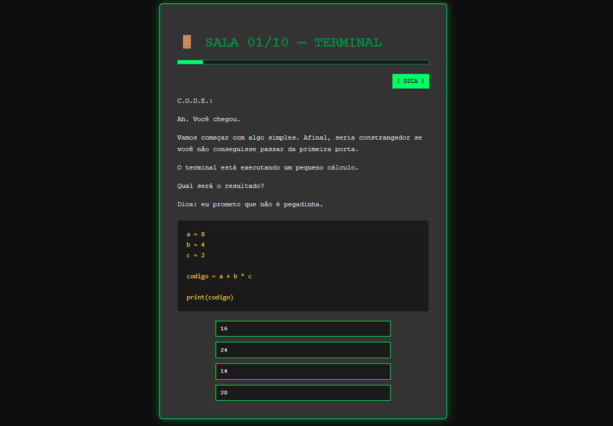
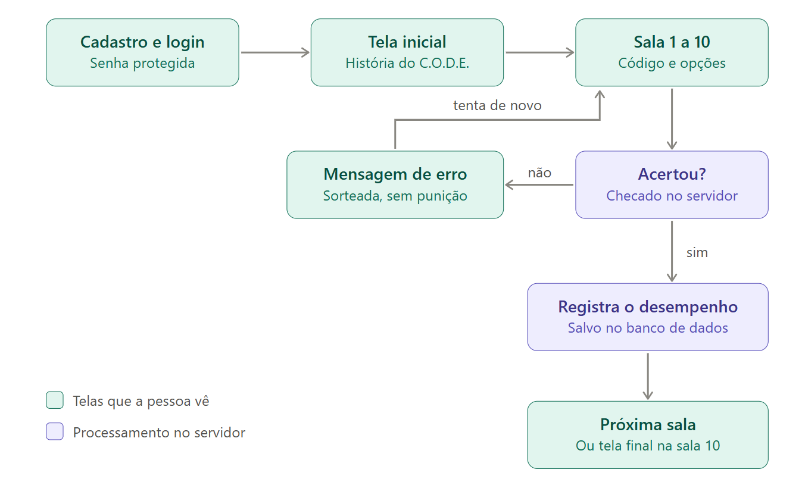
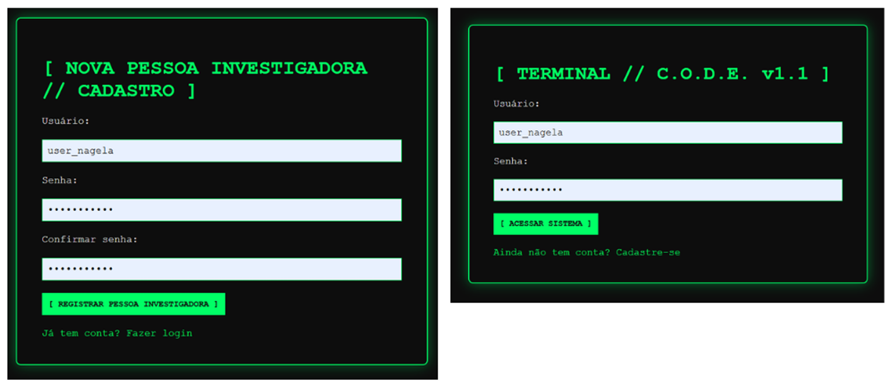
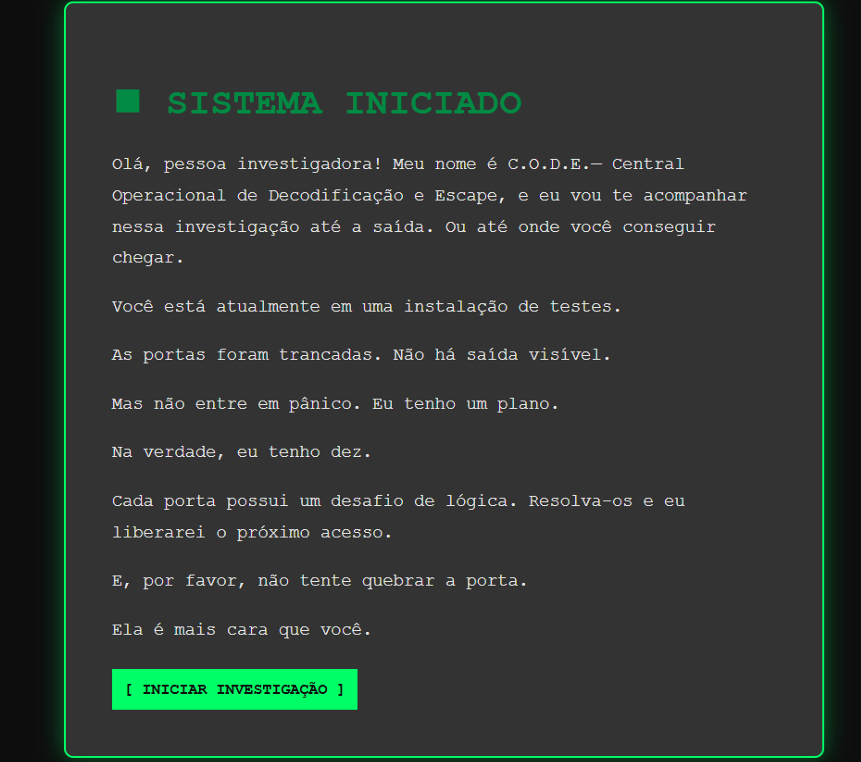
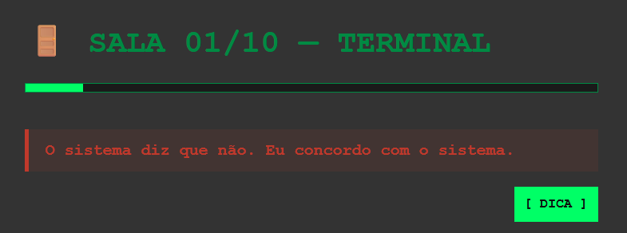
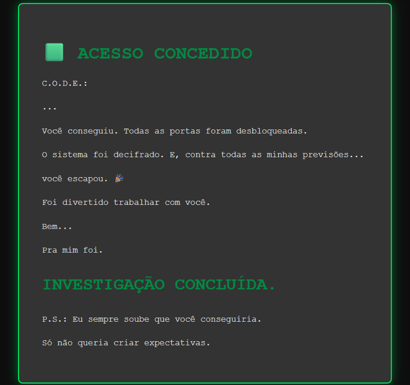
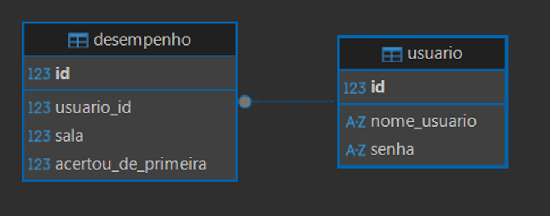

<div align="center">

# 🕹️ C.O.D.E.
### Central Operacional de Decodificação e Escape

**Um escape room narrativo para praticar lógica de programação em Python, sem pressa e sem medo de errar.**

[](https://www.python.org/)
[](https://flask.palletsprojects.com/)
[](https://www.sqlite.org/)
[](https://developer.mozilla.org/pt-BR/docs/Web/JavaScript)
[](https://escape-room-code.onrender.com)
[](#)

**[▶ Jogar agora: escape-room-code.onrender.com](https://escape-room-code.onrender.com)**

<br>



</div>

<br>

```text
> SISTEMA INICIADO
> Olá, pessoa investigadora! Meu nome é C.O.D.E.
> Você está atualmente em uma instalação de testes.
> As portas foram trancadas. Não há saída visível.
> Mas não entre em pânico. Eu tenho um plano. Na verdade, eu tenho dez.
```

> ⏳ **Sobre o primeiro acesso:** o site está hospedado em um plano gratuito, que "adormece" após um tempo sem uso. Na primeira visita, a página pode levar cerca de 50 segundos para carregar. Pelo mesmo motivo, o banco de dados não é permanente e os cadastros podem ser reiniciados de tempos em tempos.

---

## 📖 Sobre o projeto

O **C.O.D.E.** é uma aplicação Web gamificada voltada a pessoas **iniciantes em programação**. A pessoa jogadora atravessa **dez salas**; em cada uma, lê uma fala do personagem que dá nome ao projeto, analisa um trecho de código em Python, descobre mentalmente o que ele imprime e escolhe, entre **quatro alternativas**, a que corresponde à saída. Acertar abre a próxima porta. Errar rende uma mensagem bem-humorada do C.O.D.E. e uma nova chance, sempre sem penalização e sem cronômetro.

O projeto foi desenvolvido como **Projeto Integrador em Computação da [Univesp](https://univesp.br/)** (Universidade Virtual do Estado de São Paulo).

### Por que este projeto existe

A lógica de programação costuma ser uma das etapas mais desafiadoras para quem está começando. Para entender o problema de perto, realizei um questionário com mentoras e educadoras de tecnologia que atuam na formação de mulheres em cursos e bootcamps de dados e tecnologia. Cinco das oito profissionais contatadas responderam, e os resultados apontaram que:

- o maior obstáculo é **manter uma rotina de estudos e prática** (80% das respostas) e **manter a motivação** (60%);
- o **medo ou a frustração ao errar** e a dificuldade de **interpretar códigos já escritos** aparecem em 40% das respostas;
- **exercícios práticos, feedback imediato e dicas durante a resolução** estão entre as estratégias que mais funcionam (60% cada);
- **100%** das respondentes consideraram que uma ferramenta gamificada poderia ajudar bastante pessoas iniciantes.

Daí nasceu a proposta: transformar o treino de leitura e execução mental de código em uma **aventura narrativa**, conduzida por um assistente virtual de personalidade marcante, que transforma o erro em parte da brincadeira.

---

## ✨ Como funciona

<div align="center">



</div>

Em cada sala, a pessoa encontra:

- **Narrativa com efeito de digitação**, que lembra os terminais clássicos;
- **Trecho de código em Python** em destaque;
- **Quatro alternativas** de resposta;
- **Janela de confirmação** antes de enviar, com uma fala própria do C.O.D.E. em cada sala;
- **Botão de dica**, que abre uma orientação curta sobre como abordar o desafio;
- **Indicador de progresso** ("Sala 01/10" e barra de progresso);
- **Mensagens de erro acolhedoras**: são 14 variações, sorteadas a cada tentativa incorreta.

Os desafios seguem uma progressão de dificuldade: partem da precedência de operadores, passam por indexação de textos, condicionais, listas, laços de repetição e funções, avançam até dicionários e terminam em uma **sala final integradora**. Ao concluir a décima sala, a pessoa chega à tela **"Acesso concedido"**.

### Uma escolha de design

Não há cronômetro, ranking ou pontuação competitiva. A ideia é reduzir a ansiedade diante do erro, que foi justamente uma das principais dificuldades relatadas pelas educadoras consultadas.

---

## 🖼️ Telas

<div align="center">

| Login e cadastro | Tela inicial |
|:---:|:---:|
|  |  |

| Mensagem de erro | Tela final |
|:---:|:---:|
|  |  |


</div>

---

## 🧰 Tecnologias

<div align="center">
  
| Tecnologia | Papel no projeto |
|---|---|
| **Python 3** | Linguagem do servidor (a mesma dos desafios) |
| **Flask** | Framework Web: recebe os acessos, executa as rotas e devolve as páginas |
| **Flask-SQLAlchemy + SQLite** | Persistência dos dados de usuários e de desempenho |
| **Werkzeug** | Criptografia (hash) das senhas |
| **HTML5 e CSS3** | Estrutura semântica e identidade visual de terminal (Flexbox) |
| **JavaScript** | Efeito de digitação, confirmação de envio, janela de dica e progresso |
| **Git e GitHub** | Controle de versão e armazenamento do código |
| **Gunicorn + Render** | Servidor de produção e hospedagem em nuvem |

</div>

---

## 🏗️ Arquitetura

```text
escape_room/
├── app.py                 # configuração, modelos do banco e rotas
├── requirements.txt       # dependências do projeto
├── .gitignore
├── templates/             # páginas HTML
│   ├── login.html
│   ├── cadastro.html
│   ├── inicio.html
│   ├── sala1.html ... sala10.html
│   └── fim.html
├── static/                # arquivos servidos como estão
│   ├── css/style.css
│   └── js/script.js
├── docs/images/           # imagens usadas neste README
└── instance/              # criada pelo Flask; guarda o escaperoom.db (fora do Git)
```

**Como uma requisição percorre o sistema:** o navegador pede uma página (`GET /sala1`); a rota confere se a pessoa está autenticada, e o Flask devolve o HTML pronto. Ao clicar em uma alternativa, o formulário envia um `POST` com a resposta escolhida; o servidor compara com a resposta correta (que **nunca** é enviada ao navegador) e decide: grava o desempenho e redireciona para a próxima sala, ou exibe uma mensagem de erro sorteada.

As rotas do Flask funcionam como a **API interna** da aplicação: recebem pedidos do navegador, processam no servidor e retornam a resposta adequada.

### Modelo de dados

<div align="center">



</div>

A tabela `desempenho` registra, para cada sala concluída, se a pessoa acertou **de primeira** ou precisou de mais de uma tentativa. Esses dados são a base para um futuro painel de acompanhamento da pessoa instrutora.

---

## 🚀 Como executar localmente

**Pré-requisitos:** Python 3.10 ou superior e Git.

```bash
# 1. Clone o repositório
git clone https://github.com/nagelamartins/Projeto_Integrador_II-Escape_Room.git
cd Projeto_Integrador_II-Escape_Room

# 2. (Recomendado) Crie e ative um ambiente virtual
python -m venv venv
venv\Scripts\activate          # Windows
# source venv/bin/activate     # macOS / Linux

# 3. Instale as dependências
python -m pip install -r requirements.txt

# 4. Inicie a aplicação
python app.py
```

Abra **http://127.0.0.1:5000** no navegador, crie uma conta na tela de cadastro e comece a investigação.

> O banco de dados (`instance/escaperoom.db`) é criado automaticamente na primeira execução.

**Variável de ambiente opcional:** a chave que protege as sessões é lida de `SECRET_KEY`. Se ela não existir, a aplicação usa um valor padrão, adequado apenas para testes locais.

```bash
export SECRET_KEY="uma-frase-longa-e-dificil-de-adivinhar"   # macOS / Linux
$env:SECRET_KEY = "uma-frase-longa-e-dificil-de-adivinhar"   # Windows (PowerShell)
```

---

## ☁️ Publicação (Render)

A aplicação está publicada no plano gratuito do [Render](https://render.com/), conectado a este repositório:

| Configuração | Valor |
|---|---|
| Build Command | `pip install -r requirements.txt` |
| Start Command | `gunicorn app:app` |
| Variável de ambiente | `SECRET_KEY` (valor aleatório, definido no painel) |

---

## 🛡️ Boas práticas aplicadas

- **Senhas protegidas:** armazenadas apenas como *hash*, nunca na forma digitada.
- **Sessões e rotas protegidas:** as páginas do jogo só abrem para pessoas autenticadas.
- **Validação no servidor:** a resposta correta nunca é exposta no código enviado ao navegador.
- **Segredos fora do código:** a chave da aplicação é lida de variável de ambiente, já que o repositório é público.
- **HTML semântico e acessível:** uso de `main`, `form`, `label` associado a cada campo, idioma da página declarado e navegação por teclado.
- **Separação de responsabilidades:** estrutura (HTML), aparência (CSS), comportamento (JavaScript) e lógica (Python) em arquivos distintos, com reaproveitamento de classes CSS e funções JavaScript.
- **Versionamento:** commits descritivos a cada marco funcional e dependências fixadas em `requirements.txt`.

---

## 🧭 Processo de desenvolvimento

O projeto seguiu os passos **ouvir, criar e implementar**, indicados pela Univesp, associados às etapas do **Design Thinking** (empatizar, definir, idealizar, prototipar e testar):

1. **Ouvir:** brainstorming, definição da comunidade-alvo e questionário aplicado às mentoras e educadoras.
2. **Criar:** idealização do escape room, criação do personagem, definição do fluxo e da identidade visual, e prototipação das telas.
3. **Implementar:** construção da aplicação Web, publicação em nuvem, testes do fluxo completo e melhorias a partir das devolutivas, como o botão de dica e o indicador de progresso.

---

## ⚠️ Limitações e próximos passos

Como todo projeto, este também tem pontos a evoluir:

- [ ] Validar a ferramenta diretamente com **estudantes iniciantes**, medindo efeitos sobre engajamento e aprendizagem;
- [ ] Incluir **explicações após cada resposta**, para consolidar o raciocínio;
- [ ] Criar **atividades de escrita e correção de código** e exemplos com contexto real;
- [ ] Permitir **pular o efeito de digitação**;
- [ ] Construir o **painel de acompanhamento da pessoa instrutora**, a partir dos registros de desempenho;
- [ ] Migrar para um **banco de dados permanente** (por exemplo, PostgreSQL);
- [ ] Implementar **testes automatizados** (Pytest) e uma **avaliação formal de acessibilidade**;
- [ ] Ampliar o número de salas e de conceitos abordados.

---

## 👩‍💻 Autoria

Desenvolvido por **Nágela** ([@nagelamartins](https://www.linkedin.com/in/nagelamartins/)).

Conduzi todas as etapas do trabalho, do levantamento à publicação. Foi um desafio grande e, sobretudo, uma experiência de muito aprendizado: foi a primeira vez que construí uma aplicação Web do zero.

**Transparência sobre o uso de IA:** utilizei uma ferramenta de inteligência artificial generativa como apoio de estudo, para auxiliar na elaboração do formulário, na estruturação do código e na revisão dos textos do relatório. Todas as decisões de projeto, a implementação, os testes e as conclusões foram revisados e conduzidos por mim.

### Agradecimentos

Às mentoras e educadoras de tecnologia que dedicaram seu tempo a responder ao questionário, e a quem apoiou este projeto com conselhos e incentivo.

---

<div align="center">

*Feito com Python, curiosidade e um personagem de humor duvidoso.* 🚪  
*Obrigada pela visita! 💛*

</div>
